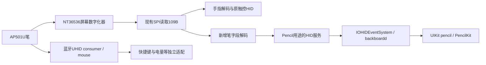

# AP501U → Y700 iPadOS 17 笔输入：探索与交接

2026-11-14。针对 TB322FC / SM8750 / NT36536，目标系统17.7.11（21H461）。
本轮完成Android只读调查、用户书写采样、原厂模块核对和参考源码审核；**没有修改XNU
触控/蓝牙驱动、没有刷机、没有改变笔配对或固件**。最后记录器已正常结束；不再占用
平板，不干扰师兄的iPadOS验证。

## 判断

**基本书写、真正的Pencil触摸类型和压感绘画，成功实现的依据较强。** 并非只有猜测：

- 本机Android已独立注册`NVTCapacitivePen`，而且这次真实写画捕获了坐标、压感、倾斜、
  悬空和按下/抬起，用户确认便签里有正常笔迹。
- 我们XNU已经使用的NT36536 SPI读取长度是109字节，原厂同长度报文的66..79区间就是笔
  数据。当前`PointReport.c`只解析手指，尚未消费笔区；有机会沿现有总线/固件扩展，
  不必另写一个“蓝牙笔迹传输”。
- 新增参考仓`research/UniXNU-gts7xlwifi`固定提交
  `88b34f97100a01aab4ea6b86dc9c748b2114c382`，README明确报告在**同版21H461**上，
  三星S Pen已作为Pencil digitizer输入、方向正确、Notes中有压感。其用户态接入比
  “手指模拟成笔”更有价值；Wacom硬件协议当然不能搬到Novatek。

这不等于已经实现完整Apple Pencil。可行性按功能拆开：

| 功能 | 当前证据 | 判断/缺口 |
| --- | --- | --- |
| 笔尖书写、点击、抬起 | 真实坐标与43次下笔/43次抬笔，现有SPI可读完整报文 | 高可行性；需加独立笔解码与HID发布 |
| 压感粗细 | 实际0..4095，接触帧中1226种正压力值；同版S Pen先例 | 高可行性；必须让UIKit force及maximumPossibleForce有效 |
| `UITouch.type == .pencil` | 同版参考已报告成功，尚未在本机iPadOS测 | 高于无先例方案；不能只看handleReport成功 |
| 倾斜笔刷 | Android有真实有符号tilt变化 | 中等；参考的IOHIDEventDriver并不自动把X/Y Tilt转为UIKit极坐标方向 |
| 悬空/靠近检测 | Android distance0/1、tool in-range、1869个非接触范围内帧 | 原始接近可行；系统Pencil hover动画/指示受机型与策略限制，另验 |
| 手掌防误触 | 尚无受控手掌实验；Android日志中通用palm rejection标志关闭 | 独立待做，不能推断Novatek固件完全没有防掌 |
| 笔按钮 | 蓝牙consumer实际6次按下/6次释放；NVT声明两barrel键 | 可做自有语义映射；未测到NVT barrel变化，不等于Pencil双击协议 |
| 笔电量、快捷面板、遥控鼠标 | 另有Bluetooth UHID设备；NVT还含battery/ID线索 | 依赖蓝牙栈和Lenovo协议；未完成电量/遥控验证 |
| Pencil配对弹窗、磁吸充电、查找、Pencil Pro挤压/旋转等 | 无等价协议/硬件证明，17也不等于最新OS | 不承诺；HID适配不会凭空获得硬件或Apple配件身份 |

用户说笔型号AP501U；Android实际蓝牙名为**Lenovo Tab Pen Plus**，VID/PID为17EF:617F。
本轮没有独立读取笔铭牌/厂商规格，报告不扩大成AP501U所有版本一致，也不将蓝牙地址公开。

## 已取得的真实日志

最终有效窗口：北京时间22:26:40–22:31:40。保存于工作台：

`edl_work/pen-feasibility-20261114/live-222640/events.txt`

归档副本：`lab/records/ap501u-feasibility-20261114/live-pen-events.txt`。
两份完整SHA256相同：`55c71eb6e53474fa0a781f53d99f15b27c3d2d8d721ae19c541f3aa17d1adccf`。
797019字节、12321条input_event、正常END/退出码0；没有记录SYN_DROPPED、HUP或读取错误。
这不是保证控制器从不丢采样，只表明该次evdev捕获没有报告这些异常。

| 数据项 | 此次实际变化范围/次数 | Android声明范围 |
| --- | --- | --- |
| 笔X | 0..17779（含退出复零） | 0..19040 |
| 笔Y | 0..26514（含退出复零） | 0..30400 |
| 压力 | 0..4095 | 0..4095 |
| Tilt X | −30..14 | −60..60 |
| Tilt Y | 0..46 | −60..60 |
| Distance | 0/1 | 0/1，非已校准毫米高度 |
| BTN_TOOL_PEN | 12次进入/12次退出 | 声明支持 |
| BTN_TOUCH | 43次按下/43次抬起 | 声明支持 |
| 蓝牙consumer KEY_UNKNOWN | 6次按下/6次释放 | MSC_SCAN值0xC0600和0xC0601 |

笔事件12291条、3510个SYN_REPORT；其中1629接触帧、1869悬空范围内帧，最后tip和range
都为0。小于100ms的正同步间隔中位4.174ms，**不是已证明的恒定采样率或端到端延迟**；
evdev只报告变化，不能把静止期/间隔过滤后倒数当硬件规格。
Bluetooth Mouse接口本轮没有事件；consumer有事件，因此按钮与笔迹是两种数据来源。
不能根据KEY_UNKNOWN猜它的用户语义，下一步应按单击/双击/长按逐一对照。

早先三轮getevent为空，另一轮native reader仅35秒心跳后随另一任务重启断开；失败记录都保留。
当时观察过熄屏/重新注册，但**没有确定空日志究竟是时间窗口、重注册还是输出缓冲造成**。
这些旧记录不能覆盖最终成功采样。一个名为`bluetooth-hid-descriptor.bin`的旧文件实际是
`cat: ... No such file`文本，已明确判为无效，不得当成HID描述符。

## 两条传输路径与实现依赖

本机`NVTCapacitivePen`的sysfs位于virtual/input，名称/路径本身不能证明总线；真正
依据是绑定在`spi0.0`的NVT-ts驱动、原厂模块的笔解析与input_event调用。
笔迹载荷来自屏幕控制器SPI，这是能先推进书写的理由。**尚未做断开蓝牙对照**：
蓝牙/厂商服务可能参与笔识别、扫描启停或最大压力重配置，不能现在承诺任何状态下
完全不需要蓝牙。推荐保留当前已知扫描配置，先观察XNU原报文，不猜测开笔命令。

## 本机原厂NT36536证据与数据格式

原厂 `/vendor/lib/modules/nvt_36xxx.ko`，604536字节，SHA256：
`a3c9fce96b453bd18ab4b44fec67db4504c65b1d5f8fc6218a19f2089be9f2a4`。
真实OF节点 `/soc/qcom,qupv3_1_geni_se@ac0000/spi@a90000/novatek@0` 有
`novatek,pen-support`属性。它和现有触控共用SPI/QUP1 SE4，**不是马达的a98000 I²C**。

下列偏移以原厂`point_data[0]`包含寄存器字节的109B缓冲为基准。由原模块指令和
Armada共享Novatek源码交叉对照，尚未取得XNU实机原始SPI笔包：

| 偏移 | 意义 | 原厂指令锚点 |
| --- | --- | --- |
| 66 | 格式：0x01笔坐标、0xFF离开、0xF0身份；还有0xF1另分支 | work+0x5CC附近，模块VA0x4318 |
| 67..68 / 69..70 | X/Y，大端u16 | 0x4334..0x4344 |
| 71..72 | 压力，大端u16 | 0x45B0、0x45E0 |
| 73 / 74 | tiltX/tiltY，有符号s8 | 0x45CC/0x45D0明确LDRSB |
| 75..76 | distance，大端u16 | 0x45B8、0x45E8 |
| 77 bit0/bit1 | 两个笔键 | 0x45EC、0x46C8；其余高位写touch_info，语义未定 |
| 78 | battery字段，单位/范围/可信度未验证 | 0x45BC、0x45F0 |
| 79 | 参考14B范围末字节，校验/保留语义未核定 | 不得自行认定为已验证校验字节 |

工作函数0x3DFC..0x3E04使用sp+0x40缓冲、读取长度109。原校验0x4038..0x4064是
bytes1..64累加，与byte65互补；**只覆盖手指区，不覆盖66..79笔区**。现有XNU同样只
核1..65，不能把手指校验通过写成“笔包CRC正确”。笔解析必须另做范围/格式/完整性与
已知校验策略，不接受损坏包造成无限按压；未识别格式不得当新坐标。

原厂`nvt_pen_max_pressure_reconfig`@0x22C8选择selector1→8191，否则4095，并注销、
重建input设备。本轮当前笔的axis最大值是4095，不盲搬某份源码的16384常量。
format0xF0分支还把67..72保存为6B笔身份并发change uevent；format0xF1需继续静态分析。
这些是识别/省电可能受厂商服务影响的线索，不应在研究阶段调用未知proc写接口。

### 现有XNU的具体缺口

- `Protocol.c::elden_nvt_points()`已读108字节payload，拼109B输出；缓冲容量无需仅为了
  66..79再扩一次，但必须核实际candidate的source fingerprint和固件扫描模式。
- `PointReport.c`仅解析10手指；建议新`PenReport.c/h`纯函数输出坐标、压力、tilt、range、
  tip、buttons、format、可选battery，错误不提交新状态。
- `Runtime.cpp`只在`same(frame, previous)`不同才发手指。**笔独立移动不能挂在这个
  条件内**；每次成功读包都单独比较/发布笔状态，即使手指数始终0。
- 现有8ms轮询及“遇缺少HID等待”的分支必须评估笔采样延迟。先复用所有权和读取，
  后按测量优化，不能为了240Hz宣传就盲调定时器或开全部中断。
- 手指ID目前映射可为1..10，不能直接借用参考的笔ID10导致冲突。独立服务仍核sender/path
  隔离；若合并报告，明确预留唯一ID（例如经检查的11），且低于原版已知31阈值。
- 保留v100已修的投递失败后提交历史、抬起补发和并发锁。参考penAction/penMergedSend
  仍可能在失败时返回success或早更新状态，不能整份替换回老问题。

## SteamOS源码：值得借鉴，但要选对来源

固定四代h0cheung `6f97250e` 的 `novatek-nvt36xxx-spi.c` **只有手指路径**，不含笔
input设备/压感解码；因此“有全部Linux源码”不等于这一份已经完成笔。

ArmadaOS `885fd1f` 的0164/0166/0167补丁则含完整Novatek笔字段和libinput适配。
0164来自SM8850共享Novatek驱动，0166/0167明确为**五代TB323FU**。可用它们理解协议，
但本机寄存器、固件、IRQ、角度/轴最大值要以四代原厂模块/实机为准。
0167作者当时没有AES笔，声明按键/方向未实测；其压力常量与本机不同，倾斜解码的
符号扩展也须用本机LDRSB证据确认，不抄错误的unsigned→int32转换。

`armada-pen-touch.py`是Game Mode兼容桥，注释明确把笔变成单指，**丢弃压感、倾斜、
悬空和按钮**，并EVIOCGRAB占用笔。它可借鉴设备重连/抬起恢复，却不适合作为Pencil
功能的目标实现；不能以“能画线”取代真正笔类型/压感验收。当前四代配置也未启用
ARMADA_GAMEMODE_PEN_TOUCH，不应默认它在此设备运行。

## iPadOS侧：优先借鉴同版S Pen成功路径

参考README（main7、2026-11-11）报告Pencil识别及Notes压感已工作；其spen-notes仍混有
combo23/24/25早期失败和“未完成”段落。以**当前源的实际分支 + 最新README**为线索，
不能把每个老试验都当最后方案，也不把外部报告当本机复现。

1. **独立Pencil服务**：参考最终形态用独立设备、keyboard-first描述符以获得用户态HID
   打开，随后准确发布PrimaryUsagePage0x0D/PrimaryUsage0x20、Built-In、DisplayIntegrated、
   DigitizerCollectionDispatch。0x0D/0x02普通Pen服务曾handleReport成功但被忽略。
   这和手指Touch Screen0x0D/4不同；不要破坏当前手指独立digitizer。
2. **匹配时机**：用途和压力上限在服务被用户态首次读取前设置。核IOHIDEventDriver
   真正有client、backboardd记录为mainDisplayPencilDigitizerService；仅驱动ready不够。
3. **接触生命周期**：tip、range、invert/eraser、barrel、坐标/压力独立编码，抬起、离开、
   蓝牙断连与屏幕休眠不能留下旧状态。浮动的笔不许被手指edge-tip wrapper强加边缘位。
4. **压力单位**：参考发现该IOHIDFamily未校准pressure会从逻辑范围映到−1..1，因此
   对称逻辑范围−4095..4095、实际发送0..4095，之后只对准确笔事件放大到其发现的UIKit
   尺度，并设置`AccurateMaxDigitizerPressureValue`。这是**版本绑定策略**，不能泛化成
   所有iOS都要乘1000；要核实际IOHIDEvent vtable/代码/ABI与force最大值，防重复缩放。
5. **倾斜**：参考声明X/Y Tilt仅被标handled，事件极坐标方向仍0。需要按这版HID事件
   的方向类型写入altitude/azimuth或合适字段；角度单位、s8符号、屏幕旋转和坐标映射
   一起核。不要设置苹果部件capability却一直送固定方向。
6. **快捷动作**：HID barrel与Pencil 2双击/UIPencilInteraction不等价。AP501U蓝牙按钮
   可以先做用户可选的橡皮/工具切换语义，需避免一个动作被SPI和蓝牙重复执行。

我们当前既有系统是iPad8,1/J317，参考是J120/Pencil-1类配置。无需为了基本Pencil
识别把整个机型换成别的iPad；hover等特色接口可能受型号控制，另行评估，不捆绑第一阶段。

## 推荐实现与验收顺序

### P0：从本次证据开始，无需再抓一堆重复日志

固定source/firmware/candidate，先做纯笔解码器：0x01正常、0xFF离开、0xF0身份、未知
格式拒绝；覆盖短包、s8负倾斜、压力超界、端点、错误后的释放，确保不动手指输出。
利用原模块静态锚点与本次evdev结果；下一次真机只加**有界原始笔区采样**，确认66..79
及0xF1/校验含义，不盲写扫描/配对命令。若XNU没有笔数据再查scan mode及Lenovo控制
服务；不要马上调BT波特率或重载触控固件。

### P1：XNU先提供真正Stylus事件，最小诊断App验证

新增笔服务/发布入口并复用原IOHIDFamily；坐标压力在内核保持定点/整数。
App显示`UITouch.type`、坐标、force/maximumPossibleForce、altitude/azimuth、时间戳、
coalesced count；用普通UIKit线段或点可视化先验输入，无需强等GPU全完成。
通过条件：笔尖进入→落下→移动→抬起→离开完整，手指同时可用，空闲无刷屏/自动输入，
force随轻重单调变化且最大值>0。记录真实事件，不只统计handleReport返回0。

### P2：PencilKit / Notes书写

用PKCanvasView分别在`.anyInput`与`.pencilOnly`策略测试：前者能画不等于已识别Pencil。
选支持压感的墨水工具看不同粗细，并同步读取force。PencilKit/Notes有渲染、Metal等
依赖；gts7xlwifi特地给MobileNotes GPU访问以获得MTLDevice。本项目GPU最后，故
“输入已通但Notes画布未工作”须按渲染故障分开，不能又去改笔协议。

### P3：倾斜、防掌、延迟与蓝牙附加

- 倾斜多方向和横竖屏对应；hover in/out与真正OS hover UI分开验。
- 手掌落在屏幕、笔悬空、两指缩放、切工具、抬笔保留手掌等场景，防掌拒绝策略需
  可撤销、及时释放。不能简单永久禁用所有手指。
- 本机43个下/上笔周期可作为正常基线；加错误、取消、旋转、休眠/重连测试。
- Bluetooth VID/PID只是识别线索，需重取真实report descriptor（旧91B文件无效）及
  明确单击/双击/长按usage；电量可能来自NVT或Bluetooth，先实证再发布。
- 不把已经配对的Lenovo笔伪报为真实Apple Pencil，不需要伪造认证。用户所需的是
  可用的笔迹/压感/倾斜功能，Apple生态配件状态另列限制。

## 交档与日志入口

- 正式证据：`docs/evidence/ap501u-feasibility-20261114.json`。
- 工作台：`lab/records/ap501u-feasibility-20261114/`，包含轴声明、成功实录、汇总与早期
  失败窗口判读。原厂module、原始Android dumpsys（可能含私人地址/界面信息）仅保留
  `edl_work/pen-feasibility-20261114`，不发布原二进制或设备地址。
- 新只读工具：`tools/device/read_y700_pen.c`；使用EVIOCGNAME/EVIOCGBIT核设备，仅
  `O_RDONLY`读取、无grab、不注入、不配置笔。按名字/节点身份处理重注册，立即刷日志，
  1..600秒自停。通过ARM64静态编译；最终v2实机结束300秒/12321事件/退出0。
- 运行任务互斥靠上层安排：**捕获窗口期间不要与别的线程同时重启/刷机**。之前窗口
  已受重启打断；本次结束后没有继续访问平板，师兄可直接开始iPadOS测试。

## 固定来源

- [三星同版成功README](https://github.com/rui12366B/UniXNU-gts7xlwifi/blob/88b34f97100a01aab4ea6b86dc9c748b2114c382/README.md)、
  [笔排障记录](https://github.com/rui12366B/UniXNU-gts7xlwifi/blob/88b34f97100a01aab4ea6b86dc9c748b2114c382/docs/spen-notes.md)、
  [HID实现](https://github.com/rui12366B/UniXNU-gts7xlwifi/blob/88b34f97100a01aab4ea6b86dc9c748b2114c382/drivers/ShengHidInput/NativeHidInput.cpp)。
- [四代NT36536基础](https://github.com/h0cheung/tb322fc-linux-kernel/blob/6f97250ead155fc3b980856323e99a4623dae73d/drivers/input/touchscreen/novatek-nvt36xxx-spi.c)。
- [Armada共享笔源码0164](https://github.com/ArmadaOS-Freedom/armadaos-freedom/blob/885fd1fdaa373f266b9a3207997b91c67aa22e6d/packages/kernel/patches/0164-Input-touchscreen-import-NT36536-host-download-SPI-d.patch)、
  [0167 libinput修补](https://github.com/ArmadaOS-Freedom/armadaos-freedom/blob/885fd1fdaa373f266b9a3207997b91c67aa22e6d/packages/kernel/patches/0167-input-nt36536-make-the-pen-a-tablet-libinput-accepts.patch)、
  [Game Mode简化桥](https://github.com/ArmadaOS-Freedom/armadaos-freedom/blob/885fd1fdaa373f266b9a3207997b91c67aa22e6d/system_files/usr/libexec/armada/armada-pen-touch.py)。
- Apple [PencilKit](https://developer.apple.com/documentation/pencilkit)、
  [Pencil触摸类型](https://developer.apple.com/documentation/uikit/uitouch/touchtype/pencil)、
  [force](https://developer.apple.com/documentation/uikit/uitouch/force)、
  [maximumPossibleForce](https://developer.apple.com/documentation/uikit/uitouch/maximumpossibleforce)、
  [altitudeAngle](https://developer.apple.com/documentation/uikit/uitouch/altitudeangle)、
  [UIPencilInteraction](https://developer.apple.com/documentation/uikit/uipencilinteraction)。
  当前公共文档包括新系统/新Pencil功能，17版范围须逐项核，不把“squeeze”等新特性当现成。

不报虚构成功概率百分比：基础书写/压感有本机数据和同版成功方法，值得实施；完整Apple
Pencil等价性、所有App兼容和低延迟体验仍须实测。建议师兄从P0/P1推进，一轮只解决
一个明确断点，保留已验手指、回程、签名floor和构建可复现性。
