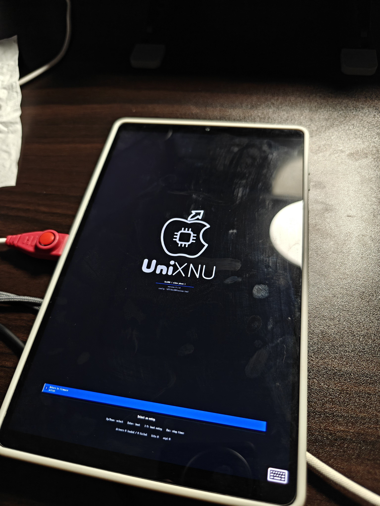

# 阶段 1 状态与实机验证

状态：**阶段 1 已通过。设备所有者使用同一镜像完成两次 RAM 冷启动，均进入
可见、可用音量键操作的 UniXNU 菜单；退出后原厂 Android 可正常启动。**

记录时间：2026-10-25

新会话继续工作请先读
[`PHASE1-HANDOFF.md`](PHASE1-HANDOFF.md)，其中包含当前构建状态、已验证修复、
旧镜像作废原因和下一步命令。

## 当前采用的新方法

本项目阶段 1 统一使用 **Intel macOS + MacPorts LLVM/LLD 20 + 直接 EDK II
CLANGPDB 构建**。不需要迁移 Linux，完整 Xcode 也不是本阶段的前置条件。
UniXNU 官方要求见 <https://unixnu.com/guide/requirements>，本地副本为
`third_party/UniXNU/docs/guide/requirements.md`。

`scripts/build_phase1.py` 调用 `scripts/build_direct_edk2.py`，通过源码构建的
BaseTools 编译固件；成功后调用 Pakala 的 `PostBuild.makeAndroidImage`，将
BootShim 与 FD 按平台原有格式打包为 Android v3 镜像，再进行产物检查。

项目入口已移除 stuart 的 setup/update/build 调用，删除了原先的 Zig 工具
包装器及其禁用 LTO 的配置改写，不再保留旧方案的操作步骤。第三方仓库自身
的上游构建文件保留，但不是本项目当前入口。

2026-10-25 已使用该入口完成通过实机验收的 DEBUG/CLANGPDB 构建。当前产物：

| 产物 | 大小 | SHA-256 |
| --- | ---: | --- |
| `out/SILICIUM_UEFI.fd` | 4,194,304 | `021a2a65db9ea5d2254604a2f81cea15fa70436f61b3591f25c056f5bcb7e37e` |
| `out/elden-phase1.img` | 2,686,976 | `b56ef4b7e5a71382b8c279c4ee1560764fabd126ba37ac0fd6e495c80b9ec6e1` |
| 内置 FAT 载荷 | 4,194,304 | `95a8e1bffc667bc7da2c4f29b18962387a1e169cf889a1a3fdbe9ba7d2089dd1` |

完整构建日志保存在 `out/phase1-build.log`。首次失败镜像仍包含
`UFSDxe`，在到达 UniXNU 菜单前发生：

```text
Data abort: Translation fault, second level
ESR: EC 0x25  IL 0x1  ISS 0x00000005
Recursive exception occurred while dumping the CPU state
```

调用栈的多层 `PC` 位于 `UFSDxe.efi`。因此已从 `APRIORI.inc`、
`DXE.dsc.inc` 和 `DXE.inc` 移除 `UFSDxe`。阶段 1 的 FAT 载荷由
`EldenRamDiskDxe`、`DiskIoDxe`、`PartitionDxe` 和 `FatDxe` 提供，不需要
UFS。新构建已通过两次实机 RAM 冷启动。

## 已确认的主机环境

| 项目 | 实际检查结果 |
| --- | --- |
| 主机 | Intel x86_64，macOS 15.8.1 |
| 项目 Python | `.venv/bin/python`，3.12.15，满足官方 3.11+ 要求 |
| MacPorts clang | `clang-20 @20.1.8_5+analyzer`，active |
| MacPorts LLVM | `llvm-20 @20.1.8_4`，active |
| LLD | `lld-link --version` 输出 `LLD 20.1.8` |
| CLANGPDB 工具 | `clang`、`lld-link`、`llvm-lib`、`llvm-rc` 均存在且可执行 |
| mtools | `mtools @4.0.49_0`，active；`mformat`、`mcopy` 可找到 |
| 其他基础工具 | git、make、unifdef 可找到；Command Line Tools 已安装 |
| EDK II BaseTools | `GenFw`、`GenFv`、`GenFfs` 已从源码构建 |
| 完整 Xcode | 暂未安装；留到后续 macOS XNU 内核构建时准备 |

LLVM 工具统一位于 `/opt/local/libexec/llvm-20/bin`。终端需要配置：

```sh
export PATH="/opt/local/libexec/llvm-20/bin:/opt/local/bin:/opt/local/sbin:$PATH"
```

构建脚本默认直接使用此目录，因此不依赖终端是否已重载 PATH。可通过
`--toolchain DIR` 显式指定包含上述四个命令的同一套 LLVM 目录。

## 已完成的准备与修复

参考仓库位于 `third_party/`，来源与版本见 [`third-party.md`](third-party.md)。
UniXNU 的 DarwinBoot 子模块和 Mu 顶层子模块已初始化，BaseTools 的 Brotli
依赖也已校正到记录提交。

`lenovo-y700g4` 的 DSC/FDF/APRIORI 已接入 `EldenRamDiskDxe`、UniXNU、
UniXNUDxe、DarwinBoot 和内置 FAT payload。阶段 1 只验证菜单，不启动 XNU。
载荷以只读 Block I/O 发布，不依赖 UFS 或 Android 可写分区。

当前载荷和构建产物已经检查：

- 4,194,304 字节 FAT16 载荷包含真实的
  `EFI/UniXNU/unixnu.toml` 长文件名；mtools 可按该路径读取，内容与源配置
  逐字节一致；
- 112 字节 AArch64 BootShim，其 magic、固件基址 `0xFF300000` 和大小
  `0x00400000` 校验通过；
- DSC/FDF/INF/GUID 静态连接检查通过；
- `out/build.json` 中记录了最终产物和载荷 SHA-256；
- Android v3 头大小已按标准修正为 1580 字节；
- RAMDisk 设备路径改用标准辅助函数，结束地址包含载荷最后一个字节；
- Crypto 归档已解压接入；构建入口把命令行绝对路径转换为 EDK II 可处理的
  工作区相对路径；
- UniXNULib 已映射，设备树代码使用 EmbeddedPkg 提供的 libfdt API；
- `verify_artifact.py` 已从最终 FD 解压 FVMAIN，并逐项确认
  `EldenRamDiskDxe`、`UniXNU`、`UniXNUDxe`、`DarwinBoot` 和 payload GUID
  存在、`UFSDxe` GUID 不存在，且卷内 4 MiB FAT 载荷与生成文件逐字节一致。

当前载荷 SHA-256：

```text
95a8e1bffc667bc7da2c4f29b18962387a1e169cf889a1a3fdbe9ba7d2089dd1
```

构建结果：内层 `FVMAIN` 为 18,403,328 字节，使用 18,402,408 字节；压缩后
`FVMAIN_COMPACT` 使用 2,725,288 / 4,194,304 字节，余量 1,469,016 字节。

## 剩余限制与实机风险

### 1. 固件 DTB 仍是占位文件

`DeviceTreeBlob/Linux/linux-y700g4.dtb` 当前内容是 6 字节的 `dummy`。
它不妨碍固件镜像构建，但不是一个有效的设备树。阶段 1 菜单不依赖该 DTB，
但设备树枚举、`compatible` 判断及后续 DT 注入不能视为已验证。进入后续启动
阶段前必须替换为真实 DTB 并重新构建。

### 2. 内层 FV 容量很紧

`FVMAIN` 当前仅剩 920 字节。后续增加、替换或增大模块时很可能溢出；届时需要
调整分区/FV 布局，不能只依赖 4 MiB 压缩后的余量。

### 3. 保留大小写不同的原厂文件

当前大小写不敏感文件系统不能同时保留 `PmicDxeLA.efi` 和
`PmicDxeLa.efi`。已核对当前 INF 选用的 `La` 文件与 git 对象内容一致，
不能据此断言当前选中的驱动已经错误。但完整源码应迁移到大小写敏感 APFS
卷或磁盘映像，保留本地集成修改，并恢复两个文件，避免后续检出覆盖。

### 4. 实机菜单已验证

设备所有者使用镜像 SHA-256
`b56ef4b7e5a71382b8c279c4ee1560764fabd126ba37ac0fd6e495c80b9ec6e1`
完成两次 RAM 冷启动，均进入 UniXNU 菜单；屏幕照片显示主菜单和
`Return to firmware` 项，音量键可移动选择。退出 RAM 启动后原厂 Android
正常恢复。阶段 1 的显示、输入、载荷配置和菜单路径均已实机确认。



## 下一步命令

阶段 1 的构建与复盘命令保留在 `docs/PHASE1.md`。后续工作转入
[`PHASE2-HANDOFF.md`](PHASE2-HANDOFF.md)。

## 最终二进制检查结果

- Android 镜像 magic 为 `ANDROID!`，头版本 v3，头大小 1580，无 ramdisk；
- gzip 解压内容与 BootShim 加 FD 完全一致；
- FD 大小为 4,194,304 字节；
- 最终 FD 内的 FVMAIN 可成功解压，FV 头、长度和扩展 section 长度一致；
- 五个必需 FV 文件 GUID 全部存在；
- `UFSDxe` GUID 不存在；
- 内嵌 FAT 载荷与生成的 4 MiB `payload.img` 完全一致。

## 阶段通过条件

以下项目均已完成：

- 设备所有者用同一 SHA-256 镜像完成两次 RAM 冷启动；
- 屏幕确认菜单可见，音量键可移动选择，配置已加载；
- 退出 RAM 启动后原厂 Android 正常恢复。

本阶段没有执行 `fastboot`、刷写、槽位切换、擦除、格式化或 GPT 修改。
阶段 1 已关闭。
